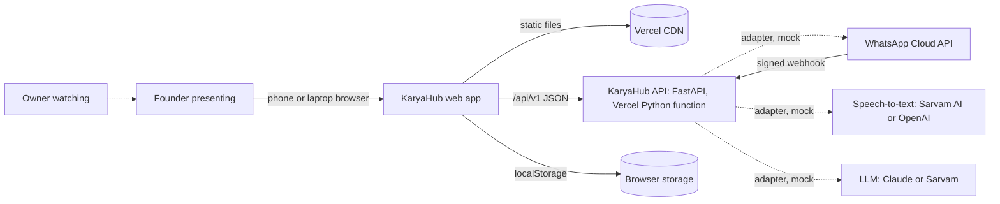
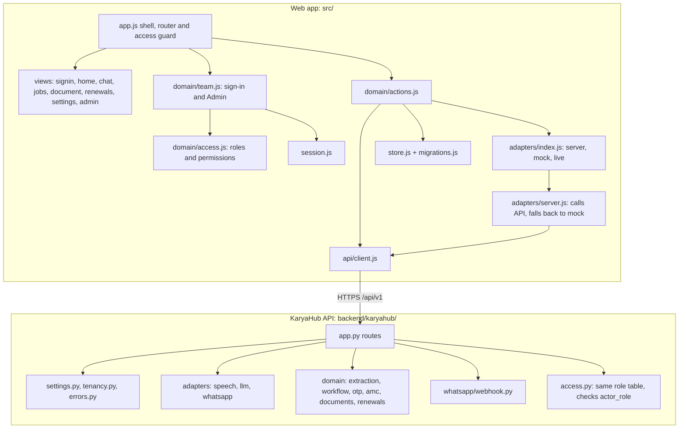
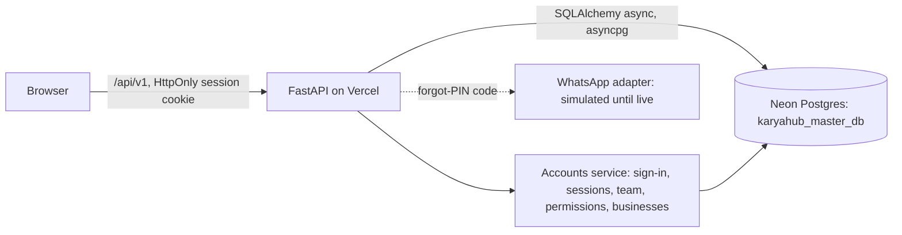
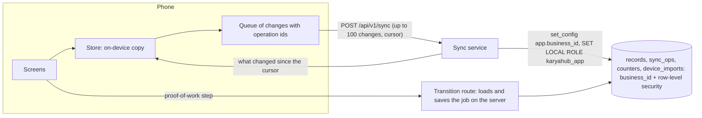

# KaryaHub: Architecture

Last updated by CR-0009. Detail: [HLD.md](HLD.md) (high level), [LLD.md](LLD.md) (low level), [RISKS.md](RISKS.md), [REFERENCE-REVIEW.md](REFERENCE-REVIEW.md).

## Context

Dotted lines are services the demo does not call: their server adapters answer with bundled mock data until keys are set.

## Components

| Component | Responsibility | Code |
|---|---|---|
| Shell and router | Sign-in gate, sidebar and tabs filtered by role, account menu, no-access page, current screen, events, theme; loads server data for a screen | `src/app.js` |
| Access (CR-0003) | Roles, permissions, route and action rules, guards, PIN hashing; sign-in, sign-out and Admin actions; who is signed in | `src/domain/access.js`, `src/domain/team.js`, `src/session.js` |
| Screens | Pure functions from state to HTML | `src/views/*.js` |
| Actions | The only way to change data; runs the pipeline through adapters; workflow and visit plan through the API | `src/domain/actions.js` |
| API client | JSON calls, plain errors, unreachable detection, timeout | `src/api/client.js` |
| Browser adapters | server (default), mock, live | `src/adapters/` |
| Store | State in localStorage (data version 3), migrations from v1 and v2, reset (keeps the team) | `src/store.js`, `src/migrations.js` |
| KaryaHub API | Routes, models, dependencies | `backend/karyahub/app.py`, entry `api/index.py` |
| Server adapters | Speech, LLM, WhatsApp: mock or live, keys from env | `backend/karyahub/adapters/` |
| Domain engine | Extraction, workflow, customer codes, AMC planner, GST, renewals | `backend/karyahub/domain/` |
| Webhook | Handshake, signature, parse, de-duplicate, hash phones | `backend/karyahub/whatsapp/webhook.py` |
| Server access (CR-0003) | Role table, `GET /api/v1/access/roles`, 403 for job actions a role may not take | `backend/karyahub/access.py` |

## API
See [LLD.md section 2](LLD.md#2-api) for every route, request, response and error code. OpenAPI: `/api/openapi.json`; docs: `/api/docs`.

## Data model
Browser state (`karyahub.demo.v1`, data version 3; the signed-in person is kept separately in `karyahub.session.v1`):

| Entity | Fields |
|---|---|
| Customer | id, name, phone, area, equipment, amc_expiry (ISO), amc_value (₹), reminded_at |
| Sample (bundled) | id, kind (voice or photo), label, technician, seconds, media_url, mock_transcript, mock_extraction (also in `backend/karyahub/data/samples.json`) |
| Message | id, from, kind (text, voice, image, process, card, document), body, at, plus kind-specific fields; cards carry reported_by |
| Job | id, customer_id, customer_name, phone, area, equipment, date, work_done, parts, amc_expiry, amc_value, lines, source_sample_id, approved_at, **state**, **events[]**, **otp** |
| Document | id, job_id, type, customer, lines, subtotal, cgst, sgst, roundOff, total, date, sent |
| Settings | business_name, address, gstin (dummy), mode (server, mock or live), simulate_failure, theme |
| Staff (CR-0003) | id, name, phone, role, active, pin_hash (salted SHA-256), created_at, last_sign_in |
| Access log (CR-0003) | id, at, who, text (newest first, at most 200) |

Server (stateless): Tenant configuration (`tenancy.py`); everything else is computed per request. When a database is added: `tenants`, `customers`, `jobs`, `job_events` (unique `(tenant_id, client_op_id)`), `wa_messages` (unique message id), `amc_visits` (unique key), all with `tenant_id` and row-level security (ADR-0009).

## Integrations and adapters

| Integration | Adapter | Current mode | To go live |
|---|---|---|---|
| WhatsApp Cloud API: incoming | `POST /api/v1/whatsapp/webhook` | Works with demo secrets in mock mode | Meta business verification, a number, `KARYAHUB_WHATSAPP_APP_SECRET`, `KARYAHUB_WHATSAPP_VERIFY_TOKEN`; register the webhook URL |
| WhatsApp Cloud API: outgoing | `adapters/whatsapp.py` (`send`) | Mock: records a simulated send | `KARYAHUB_WHATSAPP_ACCESS_TOKEN`, approved utility templates, build the live adapter |
| Speech-to-text | `adapters/speech.py` (`transcribe`) | Mock: sample transcript | `KARYAHUB_SPEECH_API_KEY`, build the live adapter (media download from Meta, then the speech API) |
| LLM | `adapters/llm.py` (`extract_job`, `read_image`): `StudioAiLlm` (CR-0004), `MockLlm`, `LiveLlm` | Studio AI (`AI_MODEL`, default `gemma4:e4b`, and `AI_MODEL_VISION` for photos, on the founder's Ollama server, through `studio_ai.py`; CR-0010) when `AI_ENDPOINTS` is set; otherwise mock. Offline or unusable answers fall back to the quick reader, labelled "Read without AI" | Link the shared `AI_ENDPOINTS` and `AI_GATEWAY_KEY` variables to the karyahub Vercel project |
| Customer codes | `domain/otp.py` | Demo secret, code shown on screen | `KARYAHUB_OTP_SECRET`, live WhatsApp sending |

## Accounts, businesses and the database (CR-0005)

- **Tables:** `businesses`, `users` (one business each; none for the platform admin), `role_permissions` and `user_permissions` (the owner's switches), `sessions` (hashed tokens), `sign_in_throttle`, `otp_challenges`, `audit_log`. Migrations are Alembic scripts in `backend/karyahub/db/migrations/`, run once per server start under an advisory lock.
- **Request path:** the cookie is looked up in `sessions`; the person, their business and their permissions (role table, then role switches, then personal switches) are loaded; each route names the permission it needs (`accounts/deps.py`); business data is always queried with the person's `business_id`.
- **Roles:** `platform_admin` (businesses only, no business data), `owner`, `coordinator`, `technician`.
- **Settings:** `DATABASE_URL` (or `KARYAHUB_DATABASE_URL`, `POSTGRES_URL`), `KARYAHUB_PIN_PEPPER`, `KARYAHUB_BOOTSTRAP_TOKEN`. Without a database address the server uses a throwaway in-memory database for local runs and tests. `/api/health` shows `database`.
- **Web app:** boots by asking `/auth/me`; keeps who is signed in in memory only; keeps each business's on-device copy under its own key (the demo business's copy is its only copy; a real business's copy is a cache of the server, see below).

## Business data, sync and the wall between businesses (CR-0009)

- **Tables (migration 0002):** `records` (one row per customer, job, document or chat message; JSON body), `sync_ops` (every applied operation id), `counters` (per-business change cursor and number counters), `device_imports` (one row per phone that moved its old data). `businesses` gains a deferred `logo_data` and `logo_version`.
- **Request path:** the signed-in person's business id (never a value from the request) is set on the transaction before any record is touched; on Postgres the transaction also switches to the restricted role so the row-level security policy binds.
- **Sync:** the phone sends `{device_id, since, ops}`; the server applies each op once (checked against `sync_ops`), gives new jobs and documents numbers, and returns the changes after `since` for the kinds the person may read. Job `state`, `events` and `otp` are changed only by the transition route.
- **Phone:** `src/sync.js` watches the store, queues a change per edited item (coalescing edits to the same item that has not been sent), persists the queue, sends it when online with growing waits, applies what comes back without re-queuing it, and shows how many changes wait.
- **Demo business:** no sync; its data stays on the device and the server refuses.

## Key flows
**Voice note to job:** pick sample → technician bubble → process card → API transcribe → API extract → draft card → Edit (optional) → Approve → Job saved at "Work done, waiting for customer check", Customer updated, totals update.

**Reading with Studio AI (CR-0004):** Chat → API `read-image` (photo as JPEG) and/or `extract` → `StudioAiLlm` → `studio_ai.chat` (first AI server that answers; 90 seconds since CR-0010, with a thinking line, Stop, and photo text streamed from `read-image/stream`; Chat warms the models through `/api/v1/ai/warm` when it opens) → Pydantic-checked job → draft card tagged "Read by AI". If no AI server answers: quick reader → draft tagged "Read without AI" with a note, and the banner (polling `/api/ai/status` every minute) says AI is offline.

**Proof of work:** Job → Send code → API `request_otp` (code bound to job and tenant, 10 minutes) → enter code → API `verify_otp` → Verified → Close → Closed; each step appended to the job's history with an idempotent operation id.

**AMC visits:** Job screen → API `amc/plan` → visits every 90 days, next due, overdue escalation, job creation 7 days ahead.

**Paperwork and reminders:** as in v0.1.0 (browser), with sends going through the server's WhatsApp adapter (simulated).

## Quality attributes
- **Security:** secrets only in server env; webhook signature checked before parsing; constant-time compares; fail closed in live mode; phones hashed in webhook answers; codes never logged.
- **Reliability:** idempotent operations; Chat falls back to the browser if the server is unreachable; data upgrades between versions.
- **Performance:** about 23 kB of gzipped JavaScript and 7 kB of CSS; API answers in milliseconds in mock mode; small Python dependency set (FastAPI, Pydantic) for quick cold starts.
- **Accessibility:** as in v0.1.0, plus labelled code input with `one-time-code` autocomplete, live status notes and alerts for errors.

## Decisions
See [../adr/](../adr/):
- [ADR-0001](../adr/0001-spec-driven-development.md) spec-driven development
- [ADR-0002](../adr/0002-vanilla-js-and-vite.md) plain JavaScript UI with Vite and Vitest
- [ADR-0003](../adr/0003-browser-storage-demo-data.md) browser storage and demo data
- [ADR-0004](../adr/0004-service-adapters-with-mocks.md) adapters with mock and live implementations
- [ADR-0005](../adr/0005-python-fastapi-back-end.md) Python FastAPI back end (CR-0002)
- [ADR-0006](../adr/0006-whatsapp-webhook-security.md) webhook security (CR-0002)
- [ADR-0007](../adr/0007-job-workflow-and-events.md) workflow and events (CR-0002)
- [ADR-0008](../adr/0008-customer-otp-proof.md) customer codes (CR-0002)
- [ADR-0009](../adr/0009-multi-tenant-ready.md) tenancy (CR-0002)
- [ADR-0010](../adr/0010-demo-sign-in-and-roles.md) demo sign-in and one shared role table (CR-0003)
- [ADR-0011](../adr/0011-studio-ai-for-the-llm.md) Studio AI for the LLM, with the quick reader as the offline fallback (CR-0004)
