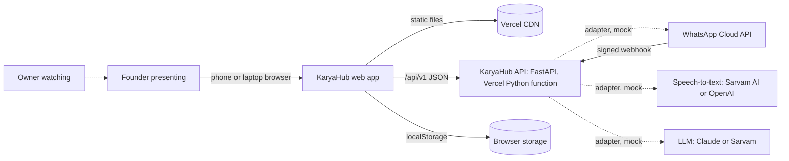
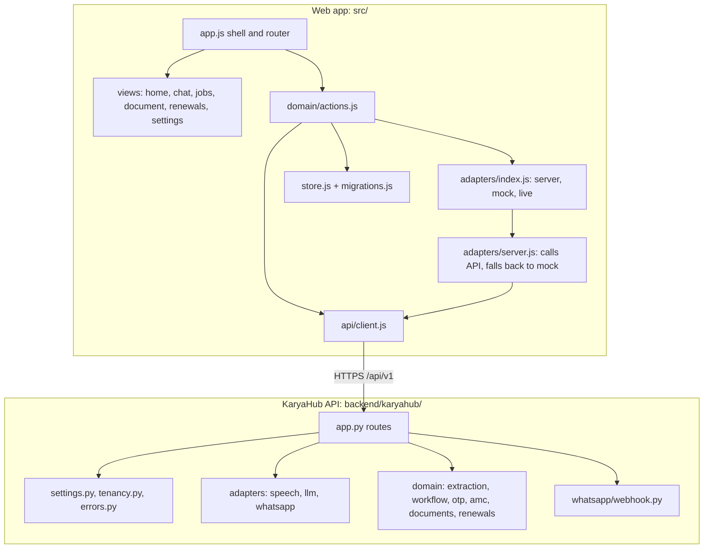

# KaryaHub: Architecture

Last updated by CR-0002. Detail: [HLD.md](HLD.md) (high level), [LLD.md](LLD.md) (low level), [RISKS.md](RISKS.md), [REFERENCE-REVIEW.md](REFERENCE-REVIEW.md).

## Context

Dotted lines are services the demo does not call: their server adapters answer with bundled mock data until keys are set.

## Components

| Component | Responsibility | Code |
|---|---|---|
| Shell and router | Top bar, tabs, current screen, events, theme; loads server data for a screen | `src/app.js` |
| Screens | Pure functions from state to HTML | `src/views/*.js` |
| Actions | The only way to change data; runs the pipeline through adapters; workflow and visit plan through the API | `src/domain/actions.js` |
| API client | JSON calls, plain errors, unreachable detection, timeout | `src/api/client.js` |
| Browser adapters | server (default), mock, live | `src/adapters/` |
| Store | State in localStorage (data version 2), migration from v1, reset | `src/store.js`, `src/migrations.js` |
| KaryaHub API | Routes, models, dependencies | `backend/karyahub/app.py`, entry `api/index.py` |
| Server adapters | Speech, LLM, WhatsApp: mock or live, keys from env | `backend/karyahub/adapters/` |
| Domain engine | Extraction, workflow, customer codes, AMC planner, GST, renewals | `backend/karyahub/domain/` |
| Webhook | Handshake, signature, parse, de-duplicate, hash phones | `backend/karyahub/whatsapp/webhook.py` |

## API
See [LLD.md section 2](LLD.md#2-api) for every route, request, response and error code. OpenAPI: `/api/openapi.json`; docs: `/api/docs`.

## Data model
Browser state (`karyahub.demo.v1`, data version 2):

| Entity | Fields |
|---|---|
| Customer | id, name, phone, area, equipment, amc_expiry (ISO), amc_value (₹), reminded_at |
| Sample (bundled) | id, kind (voice or photo), label, technician, seconds, media_url, mock_transcript, mock_extraction (also in `backend/karyahub/data/samples.json`) |
| Message | id, from, kind (text, voice, image, process, card, document), body, at, plus kind-specific fields; cards carry reported_by |
| Job | id, customer_id, customer_name, phone, area, equipment, date, work_done, parts, amc_expiry, amc_value, lines, source_sample_id, approved_at, **state**, **events[]**, **otp** |
| Document | id, job_id, type, customer, lines, subtotal, cgst, sgst, roundOff, total, date, sent |
| Settings | business_name, address, gstin (dummy), mode (server, mock or live), simulate_failure, theme |

Server (stateless): Tenant configuration (`tenancy.py`); everything else is computed per request. When a database is added: `tenants`, `customers`, `jobs`, `job_events` (unique `(tenant_id, client_op_id)`), `wa_messages` (unique message id), `amc_visits` (unique key), all with `tenant_id` and row-level security (ADR-0009).

## Integrations and adapters

| Integration | Adapter | Current mode | To go live |
|---|---|---|---|
| WhatsApp Cloud API: incoming | `POST /api/v1/whatsapp/webhook` | Works with demo secrets in mock mode | Meta business verification, a number, `KARYAHUB_WHATSAPP_APP_SECRET`, `KARYAHUB_WHATSAPP_VERIFY_TOKEN`; register the webhook URL |
| WhatsApp Cloud API: outgoing | `adapters/whatsapp.py` (`send`) | Mock: records a simulated send | `KARYAHUB_WHATSAPP_ACCESS_TOKEN`, approved utility templates, build the live adapter |
| Speech-to-text | `adapters/speech.py` (`transcribe`) | Mock: sample transcript | `KARYAHUB_SPEECH_API_KEY`, build the live adapter (media download from Meta, then the speech API) |
| LLM | `adapters/llm.py` (`extract_job`, `read_image`) | Mock: sample answers, heuristic parser | `KARYAHUB_LLM_API_KEY`, a vision-capable model, build the live adapter |
| Customer codes | `domain/otp.py` | Demo secret, code shown on screen | `KARYAHUB_OTP_SECRET`, live WhatsApp sending |

## Key flows
**Voice note to job:** pick sample → technician bubble → process card → API transcribe → API extract → draft card → Edit (optional) → Approve → Job saved at "Work done, waiting for customer check", Customer updated, totals update.

**Proof of work:** Job → Send code → API `request_otp` (code bound to job and tenant, 10 minutes) → enter code → API `verify_otp` → Verified → Close → Closed; each step appended to the job's history with an idempotent operation id.

**AMC visits:** Job screen → API `amc/plan` → visits every 90 days, next due, overdue escalation, job creation 7 days ahead.

**Paperwork and reminders:** as in v0.1.0 (browser), with sends going through the server's WhatsApp adapter (simulated).

## Quality attributes
- **Security:** secrets only in server env; webhook signature checked before parsing; constant-time compares; fail closed in live mode; phones hashed in webhook answers; codes never logged.
- **Reliability:** idempotent operations; Chat falls back to the browser if the server is unreachable; data upgrades between versions.
- **Performance:** about 23 kB of gzipped JavaScript and 7 kB of CSS; API answers in milliseconds in mock mode; small Python dependency set (FastAPI, Pydantic) for quick cold starts.
- **Accessibility:** as in v0.1.0, plus labelled code input with `one-time-code` autocomplete, live status notes and alerts for errors.

## Decisions
See [../adr/](../adr/):
- [ADR-0001](../adr/0001-spec-driven-development.md) spec-driven development
- [ADR-0002](../adr/0002-vanilla-js-and-vite.md) plain JavaScript UI with Vite and Vitest
- [ADR-0003](../adr/0003-browser-storage-demo-data.md) browser storage and demo data
- [ADR-0004](../adr/0004-service-adapters-with-mocks.md) adapters with mock and live implementations
- [ADR-0005](../adr/0005-python-fastapi-back-end.md) Python FastAPI back end (CR-0002)
- [ADR-0006](../adr/0006-whatsapp-webhook-security.md) webhook security (CR-0002)
- [ADR-0007](../adr/0007-job-workflow-and-events.md) workflow and events (CR-0002)
- [ADR-0008](../adr/0008-customer-otp-proof.md) customer codes (CR-0002)
- [ADR-0009](../adr/0009-multi-tenant-ready.md) tenancy (CR-0002)
