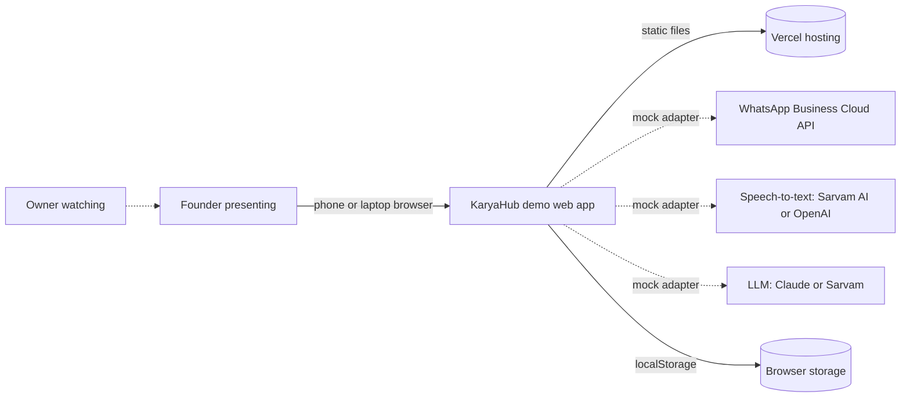
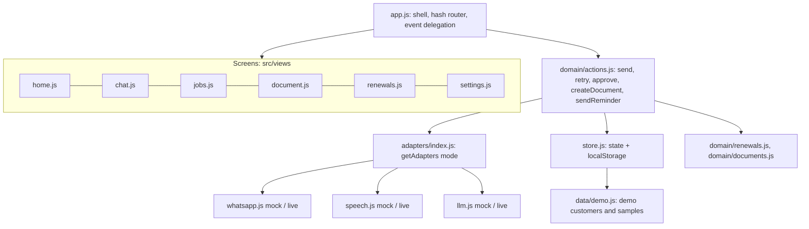

# KaryaHub: Architecture

Last updated by CR-0001.

## Context

Who and what the system talks to.

Dotted lines are services the demo does not call: their adapters answer with bundled mock responses.

## Components

| Component | Responsibility | Code |
|---|---|---|
| Shell and router | Renders the top bar, tabs and current screen; hash routes; delegated events; theme | `src/app.js`, `src/main.js` |
| Screens | Pure functions from state to HTML | `src/views/*.js` |
| Actions | The only way to change data; orchestrates adapters (Transcribe, Extract, Save) | `src/domain/actions.js` |
| Domain rules | Renewal windows, money at stake, reminder text, GST totals | `src/domain/renewals.js`, `src/domain/documents.js` |
| Adapters | WhatsApp, speech and LLM behind one interface each, mock or live | `src/adapters/` |
| Store | One JSON state object persisted to localStorage, reset to demo data | `src/store.js`, `src/data/demo.js` |
| Clock and formatting | Fixed demo date, Indian rupee formatting, dates | `src/clock.js`, `src/format.js` |

## Data model
One state object (`karyahub.demo.v1` in localStorage):

| Entity | Fields |
|---|---|
| Customer | id, name, phone, area, equipment, amc_expiry (ISO), amc_value (₹), reminded_at |
| Sample (bundled, read-only) | id, kind (voice or photo), label, technician, seconds, media_url, mock_transcript, mock_extraction |
| Message | id, from (technician, bot), kind (text, voice, image, process, card, document), body, at, plus kind-specific fields (steps, transcript, error for process; job, status, job_id for card; doc_id for document) |
| Job | id, customer_id, customer_name, phone, area, equipment, date, work_done, parts, amc_expiry, amc_value, lines, source_sample_id, approved_at |
| Document | id (QT-/INV-2027-NNNN), job_id, type (quote or invoice), customer, lines [{description, qty, rate}], subtotal, cgst, sgst, roundOff, total, date, sent |
| Settings | business_name, address, gstin (dummy), mode (mock or live), simulate_failure, theme |

Approving a card creates a Job and creates or updates the Customer (matched by phone, then name), so its AMC joins the renewals pipeline.

## Integrations and adapters
External services sit behind adapters so they can be mocked in tests and demos and swapped for real ones later.

| Integration | Adapter | Current mode | To go live |
|---|---|---|---|
| WhatsApp Business Cloud API | `src/adapters/whatsapp.js` (`sendMessage`) | Mock: records a simulated send, nothing leaves the browser | Meta business verification, a dedicated number, `WHATSAPP_ACCESS_TOKEN` in a Vercel function, plus a webhook for incoming technician messages |
| Speech-to-text | `src/adapters/speech.js` (`transcribe`) | Mock: returns the sample's bundled transcript | `SPEECH_API_KEY` (Sarvam AI or OpenAI) used from a Vercel function |
| LLM (extraction and photo reading) | `src/adapters/llm.js` (`extractJob`, `readImage`) | Mock: bundled extraction for samples, heuristic parser for free text | `LLM_API_KEY` (Claude or Sarvam), a vision-capable model for job-sheet photos, called from a Vercel function |

## Key flows
**Voice note to job (the demo's core):** pick sample → technician bubble → process card (Transcribe via speech adapter → Extract via LLM adapter → Save as draft) → "Got it. Here is what I understood" + summary card → Edit (optional) → Approve → Job saved, Customer updated, Home total and Renewals update.

**Job to paperwork:** Job detail → Create quote or Create invoice → Document computed (subtotal, CGST 9%, SGST 9%, total rounded to the rupee) → WhatsApp adapter "sends" it → chat bubble "Quotation sent to <name>" → Download opens the print dialog with print styles.

**Renewal reminder:** Renewals filter (30, 60, 90 days or Lapsed) → Send reminder → WhatsApp adapter → customer-side preview sheet → customer marked "Reminded (demo)".

## Quality attributes
- **Performance:** about 18 kB of gzipped JavaScript and 7 kB of CSS; no network calls in mock mode; fonts self-hosted.
- **Privacy:** only invented data; nothing leaves the browser; no keys in the client. Live keys must live in server functions.
- **Accessibility:** semantic landmarks, labelled inputs, visible focus, 44px tap targets, live region on the processing panel, transcripts shown as text, reduced-motion respected. Verified by the visual check and the acceptance tests' use of labels and roles.
- **Reliability of the pitch:** fixed demo date, Reset demo, and state saved on every change so a reload mid-demo keeps its place.

## Decisions
See [../adr/](../adr/). The most important so far:
- [ADR-0001](../adr/0001-spec-driven-development.md): spec-driven development.
- [ADR-0002](../adr/0002-vanilla-js-and-vite.md): plain JavaScript modules, Vite and Vitest.
- [ADR-0003](../adr/0003-browser-storage-demo-data.md): browser storage, bundled demo data, fixed demo date.
- [ADR-0004](../adr/0004-service-adapters-with-mocks.md): service adapters with mock and live implementations.
