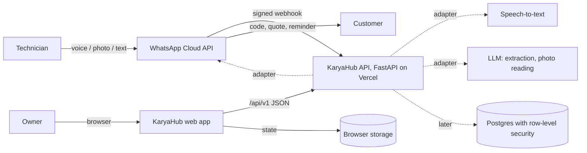
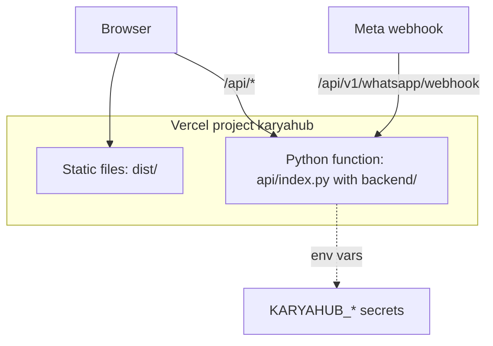

# KaryaHub: High-level design (HLD)

**Version:** 1.0, CR-0002 (2026-10-28) · **Status:** current for v0.2 · Low-level detail: [LLD.md](LLD.md) · Risks: [RISKS.md](RISKS.md) · What we learned from the reference platform: [REFERENCE-REVIEW.md](REFERENCE-REVIEW.md)

## 1. Purpose and scope
KaryaHub lets AMC service firms (AC service first) run field reporting on WhatsApp: a technician sends a voice note, a job-sheet photo or a text; KaryaHub turns it into a job record the owner approves, a quotation or GST-format invoice, a customer-confirmed proof of work, an AMC visit plan and renewal reminders.

v0.1 was a browser-only demo. v0.2 (CR-0002) adds the **KaryaHub server**: a Python API that owns the processing pipeline, the WhatsApp webhook, the job workflow and the AMC visit planner, so real services can be switched on later by setting server keys, without changing screens. It is still a demo: every outside service answers with mock data and nothing is sent.

## 2. Users and their channels
| User | Channel | What they do |
|---|---|---|
| Technician | WhatsApp (voice, photo, text) | Reports finished work |
| Owner / coordinator | Web app (phone or laptop) | Approves jobs, sends paperwork, verifies work, closes jobs, chases renewals |
| End customer | WhatsApp | Receives quotes, invoices, the one-time code, reminders |
| Founder (presenter) | Web app in demo mode | Shows the story to firm owners |

## 3. Context

Dotted lines are adapters that answer with mock data in v0.2, or parts that arrive with the database.

## 4. Building blocks
| Block | Responsibility | Technology |
|---|---|---|
| Web app | Screens, chat simulation, approvals, paperwork, renewals, proof-of-work buttons, visit plan; keeps the demo data | Plain JavaScript modules, Vite (ADR-0002), browser storage (ADR-0003) |
| KaryaHub API | Pipeline (transcribe, read photo, extract), WhatsApp webhook, job workflow and customer codes, AMC visit plan, GST totals, reminder text, tenant config | Python 3.12, FastAPI, Pydantic v2 (ADR-0005), one Vercel Python function |
| Adapters | Speech, LLM and WhatsApp behind one interface each, mock or live, keys only on the server | `backend/karyahub/adapters/` (ADR-0004, extended) |
| Domain engine | Pure functions: extraction, workflow, OTP, AMC planner, documents, renewals | `backend/karyahub/domain/` |
| Hosting | Static UI on Vercel's CDN; `/api/*` rewritten to the Python function | `vercel.json` |

## 5. Key flows
1. **Technician report (web demo):** sample picked in Chat, then the web app calls `POST /api/v1/pipeline/transcribe` (or `read-image`), then `POST /api/v1/pipeline/extract`, then shows the draft card; the owner edits and approves; the job is saved in the browser at `WORK_DONE`.
2. **Technician report (real WhatsApp, later):** Meta posts to `POST /api/v1/whatsapp/webhook`; the API checks `X-Hub-Signature-256`, de-duplicates by message id, runs the same pipeline and returns the drafts. With a database, the draft is stored and the owner sees it in the web app.
3. **Proof of work:** owner presses Send code, then `POST /api/v1/jobs/{id}/transitions` with `request_otp`; the server issues a 6-digit code bound to the job and tenant, signed and time-limited, and sends it to the customer (simulated). The customer reads the code to the technician or owner; `verify_otp` moves the job to `VERIFIED`; `close` to `CLOSED`.
4. **AMC visits:** job screen calls `POST /api/v1/amc/plan`; the server lists visits every 90 days, which job to create 7 days ahead, and who to tell when a visit is overdue.
5. **Paperwork and renewals:** as in v0.1, in the browser; the server has the same rules (`/documents/totals`, `/renewals/*`) ready for when data moves server-side.

## 6. Deployment

- One Vercel project, one repository. Previews per pull request; production only on release.
- The function is stateless (no memory or disk between requests). Persistent data stays in the browser until the founder adds a database.
- Configuration by environment variables: `KARYAHUB_MODE` (mock or live), `KARYAHUB_WHATSAPP_APP_SECRET`, `KARYAHUB_WHATSAPP_VERIFY_TOKEN`, `KARYAHUB_WHATSAPP_ACCESS_TOKEN`, `KARYAHUB_SPEECH_API_KEY`, `KARYAHUB_LLM_API_KEY`, `KARYAHUB_OTP_SECRET`.

## 7. Cross-cutting decisions
- **Fail closed:** in live mode a missing secret stops the feature with "Not configured: add ... key" (503); demo secrets exist only in mock mode.
- **Idempotency everywhere:** WhatsApp message ids, client operation ids on workflow actions, deterministic event ids, unique AMC visit keys.
- **Privacy:** phones are hashed in webhook results; codes and challenges never land in the event log; all demo data is invented.
- **Resilience of the demo:** if the API can't be reached, Chat falls back to the in-browser mocks and says so; proof of work and visit plans wait for the server.
- **Multi-tenant ready:** every server answer carries a tenant id; tenants are configuration now and database rows with row-level security later (ADR-0009).

## 8. Roadmap (beyond CR-0002)
| Step | Needs from the founder | Unlocks |
|---|---|---|
| Postgres (Vercel Marketplace) + Alembic + row-level security | Add the database | Shared data across devices, cross-delivery de-duplication, OTP attempt limits, audit log |
| Real speech and LLM adapters | API keys (Sarvam AI or OpenAI; Claude) | Real voice notes and job sheets |
| Real WhatsApp | Meta business verification, a number, app secret and token | Live intake and sending |
| Owner login (OTP) | None | Multiple owners, per-firm data |
| React or Vue + TypeScript UI, Hindi strings | None | Richer screens, technician view |
| Queue for webhook processing | Database first | Fast webhook acknowledgement at volume |
