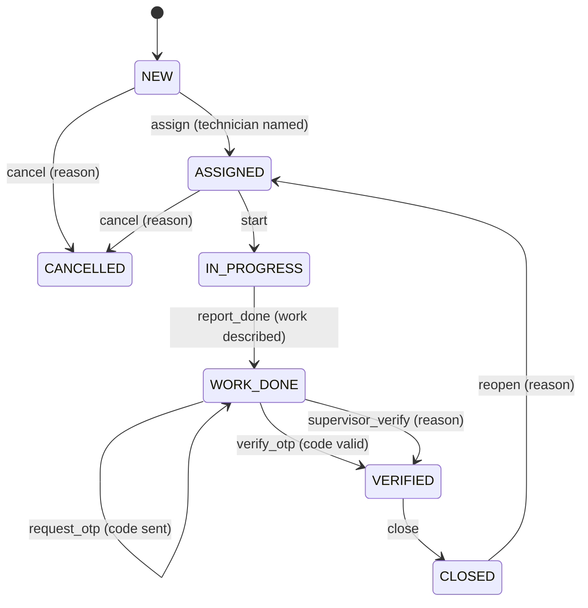

# KaryaHub: Low-level design (LLD)

**Version:** 1.0, CR-0002 (2026-10-28) · High-level view: [HLD.md](HLD.md)

## 1. Code layout
```
api/index.py                      Vercel entry: exposes the FastAPI app
backend/karyahub/
  app.py                          routes, request/response models, dependencies
  settings.py                     KARYAHUB_* environment variables, demo secrets (mock only)
  errors.py                       AppError and handlers: {"error": {"code", "message"}}
  tenancy.py                      Tenant model and the demo tenant
  adapters/                       speech.py, llm.py, whatsapp.py (Mock* and Live*), __init__.py (get_adapters)
  domain/extraction.py            samples + heuristic extraction (JobDraft, Extraction)
  domain/workflow.py              states, actions, guards, transition(), event ids
  domain/otp.py                   issue() and verify() for customer codes
  domain/amc.py                   Contract, Visit, Plan, plan()
  domain/documents.py             GST totals in paise
  domain/renewals.py              due windows, lapsed, reminder text
  whatsapp/webhook.py             handshake, signature, parse, phone hash
  data/samples.json               the demo samples (same as src/data/demo.js)
src/api/client.js                 fetch wrapper: ApiError, ApiUnreachable, 8 s timeout
src/adapters/server.js            server adapters with in-browser fallback
src/migrations.js                 browser data v1 -> v2
tests/api/                        pytest acceptance tests (server)
tests/*.test.js                   Vitest acceptance tests (web app), tests/fake-api.js
```

## 2. API
Base path `/api`. OpenAPI at `/api/openapi.json`, docs at `/api/docs`. Tenant from the `X-Tenant-Id` header (defaults to the demo tenant).

| Method and path | Request | Response |
|---|---|---|
| GET `/api/health` | none | `{status, service, version, mode}` |
| GET `/api/v1/meta` | none | `{version, mode, tenant, services[{id, name, key, configured, status}], workflow{states, actions}}` |
| POST `/api/v1/pipeline/transcribe` | `{media_id, simulate_failure}` | `{text, language, adapter}` |
| POST `/api/v1/pipeline/read-image` | `{media_id, simulate_failure}` | `{text, adapter}` |
| POST `/api/v1/pipeline/extract` | `{text (1 to 4000), simulate_failure}` | `{found, job?, missing[], adapter}` |
| POST `/api/v1/messages/send` | `{to, kind text or document or template, body}` | `{id, status simulated, kind}` |
| POST `/api/v1/documents/totals` | `{lines[{description, qty, rate}], inter_state}` | `{subtotal, cgst, sgst, igst, roundOff, total, invalid}` |
| POST `/api/v1/renewals/due` | `{customers[], today, days}` | `{due[], lapsed[], money_at_stake}` |
| POST `/api/v1/renewals/reminder-text` | `{customer, today}` | `{text}` |
| POST `/api/v1/jobs/{job_id}/transitions` | `TransitionRequest` (below) | `TransitionResult` (below) |
| POST `/api/v1/amc/plan` | `{contract{customer_id, ends_on, starts_on?, every_days 7 to 366, lead_days 0 to 60}, today, existing_keys[]}` | `Plan` (below) |
| GET `/api/v1/whatsapp/webhook` | `hub.mode, hub.verify_token, hub.challenge` | the challenge as text, or 403 |
| POST `/api/v1/whatsapp/webhook` | Meta payload + `X-Hub-Signature-256` | `{received, duplicates, results[{id, type, from_hash, status, transcript?, extraction?, error?}]}` |

**Errors** always look like `{"error": {"code": "...", "message": "..."}}`:

| Code | Status | When |
|---|---|---|
| `validation_error` | 422 | Request fails its Pydantic model ("Check text: ...") |
| `read_failed` | 422 | The message can't be read (or Simulate failure is on) |
| `not_configured` | 503 | Live mode and a needed key or secret is missing |
| `not_built` | 501 | Live mode with a key, but that live adapter isn't built yet |
| `invalid_transition` | 409 | Action not allowed in the job's state |
| `guard_failed` | 422 | A guard refused (no technician, no reason, wrong or expired code) |
| `unknown_state`, `unknown_action` | 422 | Bad workflow input |
| `bad_signature` | 401 | Webhook signature missing or wrong |
| `forbidden` | 403 | Webhook verify token mismatch |
| `invalid_contract` | 422 | AMC contract ends before it starts |
| `not_found` | 404 | Unknown path |
| `internal_error` | 500 | Anything unexpected (no details leak) |

## 3. Job workflow



Jobs created from a technician's WhatsApp report start at `WORK_DONE` (the report is the "work done" event). A job can only be closed after it is verified.

**TransitionRequest:** `state`, `action`, `client_op_id` (6 to 80 chars, unique per operation), `applied_op_ids[]` (op ids already on the job), `payload{technician?, reason?, code?, challenge?, phone?, work_done?}`, `actor`, `channel` (whatsapp, web, system), `captured_at` (device time), `work_done`.

**Engine (`workflow.transition`):**
1. Unknown state or action: 422.
2. `client_op_id` already applied: return `duplicate: true`, same state, no event.
3. State not in the action's `from_states`: 409 `invalid_transition`.
4. Run each guard; the first problem is returned as 422 `guard_failed`.
5. Build the event: `id = "ev-" + sha256(tenant|job|client_op_id)[:16]` (the same op always gets the same id), `received_at` = server time, payload without `code` and `challenge`.
6. Return `TransitionResult{job_id, tenant_id, state, state_label, duplicate, event, next_actions[], otp?}`.

The caller stores the state and appends the event (browser today; a `job_events` table later, with a unique index on `(tenant_id, client_op_id)`).

## 4. Customer one-time code
- `issue(job, tenant, secret, ttl=600 s)`: body = base64url JSON `{j, t, e (expiry, unix), n (nonce)}`; code = 6 random digits (`secrets`); challenge = `body + "." + base64url(HMAC-SHA256(secret, body + "." + code))`.
- `verify(challenge, code, job, tenant, secret)`: parse, check job and tenant match, not expired, digits only, length 6, constant-time compare of the MAC.
- Mock mode returns `demo_code` so the presenter can play the customer; live mode never returns the code (it goes to the customer on WhatsApp).
- Not yet: attempt limits and single use (need storage; RISKS R-07).

## 5. AMC visit planner
- `starts_on` defaults to `ends_on - 365 days`. Visits at `starts_on + k * every_days` for k = 1, 2, ... while on or before `ends_on`.
- Key `visit:<customer_id>:<due_on>`; `create_job_on = due_on - lead_days`.
- Status per visit, in order: `job_created` (key already used), `past` (more than 30 days before today: before KaryaHub tracked it), `overdue` (due date passed; escalate to `coordinator`, or `owner` after 2 days), `create_job_now` (inside the lead time), `upcoming`.
- `jobs_to_create` lists overdue and create-now keys that have no job; a scheduler (later) creates exactly these, so re-running never duplicates.

## 6. WhatsApp webhook
1. GET: `hub.mode == "subscribe"` and constant-time match of `hub.verify_token`, then echo `hub.challenge`, else 403.
2. POST: secret required (503 in live mode without it); compute `sha256=` HMAC of the **raw body**; compare constant-time with `X-Hub-Signature-256`; 401 on mismatch. Only then parse JSON (400 if invalid).
3. Walk `entry[].changes[].value.messages[]`; skip status updates; de-duplicate by `id` (counted in `duplicates`).
4. Each message: text then extract; audio then speech adapter, then extract; image then LLM read, then extract; other types fail with `unsupported`. Failures are reported per message; the webhook still answers 200 so Meta doesn't retry endlessly.
5. The sender's phone is returned only as `from_hash` = HMAC(secret, phone)[:16].

## 7. Web app changes
- **Adapters:** `getAdapters(mode, api)` with modes `server` (default), `mock`, `live`. Server adapters call the API; on `ApiUnreachable` (network error, timeout or a non-JSON answer) they fall back to the in-browser mock and mark the result `_via: "fallback"`, shown in the step detail.
- **Actions:** `transition(jobId, action, payload)` and `amcPlan(jobId)` call the API only (business rules live on the server); unreachable server returns a plain error and changes nothing.
- **Data (browser storage key `karyahub.demo.v1`, data version 2):** Job gains `state`, `events[]` and `otp{challenge, expires_at, demo_code}`. `src/migrations.js` upgrades version 1 data on load: jobs become `WORK_DONE` with one explanatory event; nothing else changes.

## 8. Testing
- **Server (pytest, `tests/api/`):** one test per server criterion, named `test_ac_<story>_<n>_...`, using FastAPI's test client, with environment cleared per test; live-mode tests set `KARYAHUB_MODE=live`.
- **Web app (Vitest + jsdom, `tests/`):** UI criteria run against the real app with `tests/fake-api.js` standing in for the server (records calls; can simulate an unreachable server).
- **End to end (manual, in the visual check):** built UI with `vite preview` proxied to `uvicorn api.index:app`, driven by Playwright through chat, approve, code, verify, close and settings.
