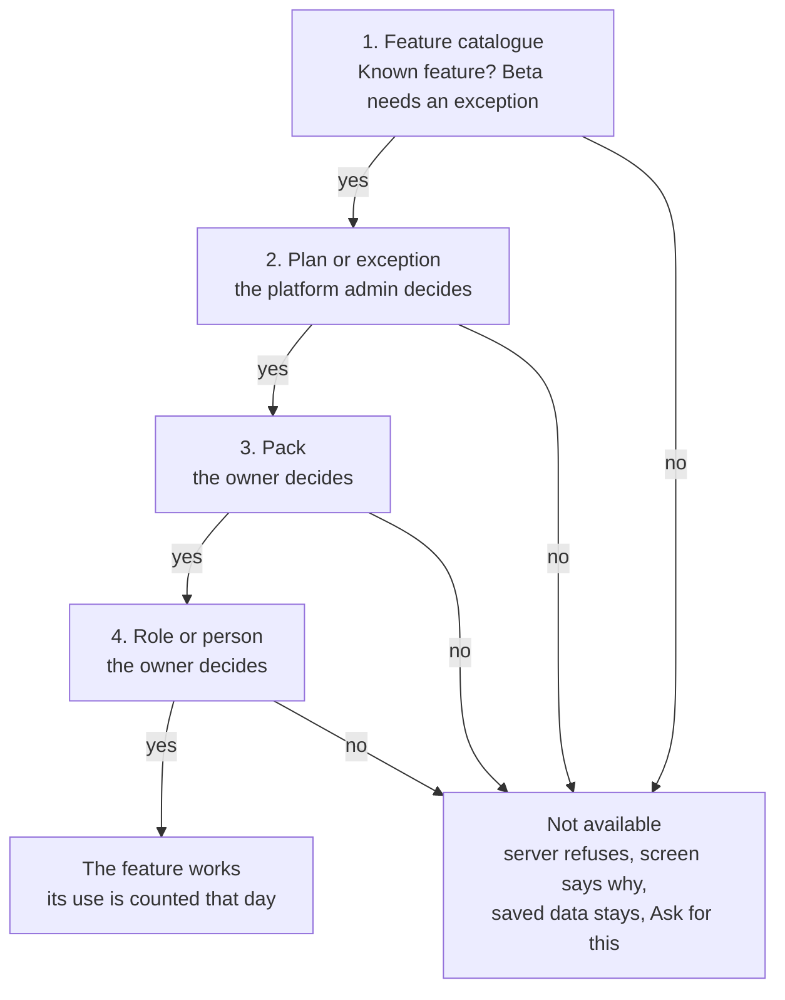

# Phase Alpha: the platform admin console

- **Status:** Approved by the founder on 4 Nov 2026; not built yet.
- **Change request:** [CR-0018](../changes/CR-0018-platform-console.md) · **Release:** v0.12.0
- **Stories and criteria:** US-44 to US-49 in [SPEC.md](../spec/SPEC.md) (61 criteria)
- **Tracking:** the Phase Alpha epic and one GitHub issue per story (see [TRACKING.md](../process/TRACKING.md))
- **Not in this file:** the business reasoning, competitor prices, risks and legal notes are kept in the private Idea Studio document, not in this public repository.

Phase Alpha combines three earlier ideas (A: overview and a page per business; B: warnings; C: plans and feature switches) with 15 additions from a brainstorm, into one release: a seven-tab console for the platform admin.

It answers four questions each morning: who is stuck, who gets real value, who pays and is due, and what to build next. New features later need only one catalogue entry and one server check.

Three rules shape it:

- **Counts, not contents.** The platform admin sees how much each business does, not its customers or bills.
- **Nothing breaks on release.** Every business starts with everything on, and a bill is never refused because of a plan.
- **Payments are by hand for now.** No payment provider or new account is needed.

## What the admin needs, and what KaryaHub records today

| The question | What answers it | Do we record it today? |
|---|---|---|
| Who is stuck or slipping, and whom do I call? | A short attention list with the reason and the action | Partly. Sign-in time, temporary PIN and setup state exist. Nothing joins them. |
| Is each customer getting real value? | Setup steps reached, bills and jobs made, last real use | Partly. Records exist, but only inside each business's wall. Nothing counts them per day. |
| Who pays, how much, and who is due? | Plan, end date, payments received, renewals due | No. No plan, price or payment is recorded anywhere. |

What the code already gives, and what that changed in the plan:

- **Sign-in history already exists.** Every successful sign-in is in the activity log with its time and business, so the sign-in graph can start from the past. Wrong PINs are not kept (only a running count that resets on lockout), so that history starts at release.
- **"Signed in" is a weak signal.** A technician may work only through WhatsApp and never sign in, and a phone can work offline and sync later. Alpha adds "last seen", updated when a phone syncs, and warns only about owners and office staff.
- **The wall between businesses must hold.** Customer records sit behind row-level security, per business. The console does not read them. It keeps a separate daily count per business, with numbers only.
- **Some of it is half built.** WhatsApp messages are already counted per business per month, and packs already switch features off with a clear refusal from the server (the data stays). Alpha extends these instead of adding a second system.
- **A turned-off business** currently shows the same "wrong PIN" message as a typo. Alpha shows a clear "paused" message.

## What the brainstorm added beyond A, B and C

The brainstorm adds 15 things to Alpha. Most exist to help the platform admin grow the business and to make later features cheap to add.

### Added to Alpha

| Idea | What it gives the platform admin |
|---|---|
| Stage and source for each business (Trial, Pilot, Paying, At risk, Left; trade, city, who referred them) | A view of the customer pipeline, and which channel and trade works |
| Notes and follow-up dates | The admin remembers what each owner said, and overdue calls appear in the attention list |
| Payments received, typed by hand | Money received, monthly run rate and renewals due, with no payment provider needed |
| Setup ladder (seven steps, first sign-in to second active week) | Shows exactly where owners get stuck |
| Named health states with a reason | "Slowing: no bill for 9 days" tells more than "62/100" |
| A "test business" tick | Test accounts stay out of the totals and graphs |
| Feature catalogue | A new feature takes one catalogue entry and then appears in Plans and on every business page |
| Per-business exceptions with a reason and end date | Give one owner Premium for a month, and it ends by itself |
| Beta features | Try a new feature with chosen businesses before everyone |
| "Ask for this" button and feature use table | Shows what to build next, and who would pay for it |
| Running cost per business | AI calls and messages, times rates the admin sets, against what that business pays |
| System tab | Version, database, row-level security, server mode and AI status in one place |
| Announcements | Tell everyone, one plan or one business about news or downtime, through a banner in the app |
| A clear "paused" message | A turned-off business stops seeing "wrong PIN" after typing the right one |
| "Your plan" card for owners | Owners see plan, end date and usage, which also prompts upgrades |

### Left for later

| Idea | Why not now |
|---|---|
| Online payments and automatic renewal | Needs a payment provider account from the founder, and proven prices first |
| Morning summary on WhatsApp | Needs K6 real sending |
| Looking inside a business, with the owner's consent | High trust risk. Wait until the first pilots show a real need |
| Second admin with limited rights | No second person yet |
| Retention by joining month | Too few businesses for it to mean anything; revisit at about 20 |
| Weighted health score | Needs real data on who left |
| Data export and delete on request | Already planned in K8 |
| Public trial sign-up form | Worth doing once the 5-owner test shows owners stay |

### Decided against

- **Rupee totals per business in the console.** An owner's turnover is sensitive, and it is not needed to see who is active. Alpha shows bill counts only. This is your call: see the open questions.
- **Plan limits on bills, items and customers.** A bill typed at a counter, perhaps offline, must always save. Limits apply only to AI calls and people. Message limits wait for K6, because today's messages go through the owner's own WhatsApp link and cost nothing.

## Phase Alpha scope: seven tabs

The platform admin's sidebar grows from one item, Businesses, to seven tabs. Overview is where the admin lands.

| Tab | What it shows | What the admin does there |
|---|---|---|
| **Overview** | Attention count, five totals, four graphs, setup ladder | See the state of KaryaHub in a minute |
| **Businesses** | Table with trade, state, plan, stage, people, last active and health; filters and search | Find a business, add one, export the list |
| **People** | Everyone on KaryaHub, with totals per business | Filter by business, role, active or off, never signed in, temporary PIN, locked, not seen for 14 days |
| **Attention** | Every warning, most serious first, with its reason and action | Act, or snooze with a reason |
| **Plans** | Feature catalogue and plans, with their switches, limits and prices | Change a plan, add a plan, mark a feature Beta |
| **Growth** | Stages, follow-ups, payments, renewals due, feature use and requests, running cost, announcements | Run the customer list and decide what to build |
| **System** | Version, database, row-level security, server mode, AI servers, admin log | Check KaryaHub itself and see who changed what |

**Graphs:** sign-ins per day; active businesses per week; bills, jobs and items made per day; new businesses per month. Each has 7, 30 and 90 day views, or 3, 6 and 12 months for new businesses, plus a plain table. Days follow India time.

**A business's page:** summary and health; people, filterable; usage against limits; plan and exceptions; notes and follow-ups; payments; admin actions on that business.

### The setup ladder

Counts are shown for each step, so the admin can see where owners stop. The first bill saved is what counts as real use.

1. Owner signed in for the first time
2. Owner chose their own PIN
3. Business setup finished
4. First item or customer added
5. First bill saved
6. First bill sent
7. Active in a second week

### Health states

A business has one state at a time, always shown with its reason. These cut-offs are starting guesses, to be checked once real businesses exist.

| State | Rule |
|---|---|
| Setting up | Has not saved a first bill or job yet |
| Active | Bill, job, item or stock change within the last 7 days |
| Slowing | Last such change was 8 to 14 days ago |
| Quiet | Nothing for more than 14 days |
| Paused | Turned off by the platform admin |

### Warnings

Each warning names the business and offers one action.

| Warning | Raised when | Level | Action |
|---|---|---|---|
| Row-level security not on | Health reports anything other than "on" | Critical | Open System |
| Mock mode with real businesses | Server mode is mock and a real business exists | Critical | Open System |
| The admin's own account locked | 5 wrong PINs on the platform admin's number | Critical | Open admin log |
| No active owner | A business has no owner who can sign in | Critical | Open business |
| AI server offline | No AI server answers | High | Open System |
| Account locked | 5 wrong PINs on one number | High | Reset PIN |
| Many wrong PINs | Unusually many across all numbers in a day (cut-off set during the build) | High | Open System |
| Plan ended, in grace | End date passed, 7 days to fall back | High | Open plan |
| Owner never signed in | 3 days after creation | Medium | Reset PIN |
| Still on temporary PIN | 3 days after the first PIN was issued | Medium | Reset PIN |
| Setup not finished | 3 days after first sign-in | Medium | Open business |
| No first bill | 7 days after creation | Medium | Add note |
| Went quiet | Was active, then nothing for 14 days | Medium | Add note |
| Limit nearly reached | 80% of the monthly AI limit or the people limit | Medium | Open plan |
| Plan ends soon | Within 14 days | Medium | Open plan |
| Follow-up overdue | Follow-up date has passed | Low | Open notes |

Technicians who never sign in raise no warning, because they may work only through WhatsApp.

## How it is built, and how future features plug in

A future feature needs one catalogue entry and one server check. The console's own tables hold counts and account details, never customer records.

**Stack:** unchanged, tier R: plain JS (Vite) screens and FastAPI on Vercel, with Neon Postgres. Graphs are inline SVG, with no new library. The design rules in `docs/design/DESIGN.md` apply. One new decision record (ADR) covers counts outside the wall and the plan system; it is written with the build.

### Adding a feature later

1. Add one entry to the catalogue: its key, name, kind (switch or limit), state (Beta or Live), and whether it is core.
2. Add its check at the server route, using the same refusal packs already use.
3. It now appears in Plans and on every business page, and is counted in feature use. No console screen changes.

The first catalogue covers AI notes, AI photos, WhatsApp sending, PDF links, the Field service, Trading and Shop counter packs, History, CSV import and own item details. Limits cover people, AI calls a month and messages a month. Getting paid and voice notes join it as one entry each when they are built.

Gates 3 and 4 already exist. Alpha adds gates 1 and 2 in front of them. Core features (bills, items, customers, seeing saved data) can't be turned off at gate 2.

### New data

All of it arrives through one new migration, which runs at start-up as today. Existing tables keep their shape, apart from one new column on `users`.

| Table | Holds | Personal data? |
|---|---|---|
| `plans` | Name, price, billing period, switches and limits, fallback plan, retired flag | No |
| `business_accounts` | One row per business: plan, start and end dates, stage, trade, city, source, referred by, test tick | No |
| `feature_overrides` | Business, feature, value, end date, reason, who set it | No |
| `usage_daily` | Business, India day, metric, count | No |
| `sign_in_events` | Time, user or masked number, business, result; kept 13 months | Masked number |
| `users.last_seen_at` | New column, updated on sync at most hourly | Yes, like last sign-in |
| `account_notes` | Business, text, follow-up date, who wrote it | Possibly, in the admin's own words |
| `payments_received` | Business, amount in paise, date, mode, period, note | No |
| `feature_requests` | Business, person, feature, time, status | Name of the asker |
| `announcements` | Title, text, audience, start and end dates | No |
| `warning_snoozes` | Warning, subject, until, reason, who | No |
| `platform_settings` | Cost rates and the support contact | Contact only |

`usage_daily` is added to in the same transaction as the work it counts, the same pattern as today's monthly message counter.

**Keeping owners' History clean:** owner History reads every activity-log line carrying the business's id. Notes, stages and payments therefore never go into that log. They go into one more new table, `platform_log`, which no owner route reads. Only plan and feature changes appear in History.

### Filling in the past

Sign-ins fill from the existing activity log. For bills, jobs and items, a Rebuild numbers action on System reads each business inside its own wall. Records keep no creation date, so it uses their saved history or last-changed date, and those days are marked as estimates.

### New server routes

All sit under `/api/v1/platform/`, and all need the platform admin's `manage_businesses` permission.

| Method and path | Purpose |
|---|---|
| `GET overview?range=` | Totals, graphs, ladder |
| `GET businesses?filters`, `GET businesses/{id}` | List and business page |
| `PATCH businesses/{id}/account` | Stage, trade, city, source, test tick |
| `GET people?filters`, `POST people/{id}/reveal` | People list and logged phone reveal |
| `GET warnings`, `POST warnings/snooze` | Attention list |
| `GET plans`, `POST plans`, `PATCH plans/{id}` | Plans |
| `GET features` | Catalogue with Beta or Live state |
| `PUT businesses/{id}/plan`, `PUT businesses/{id}/overrides/{feature}` | Plan and exceptions |
| `POST businesses/{id}/notes`, `POST businesses/{id}/payments` | Notes and payments |
| `GET growth` | Stages, money, renewals, demand, cost |
| `GET system`, `GET log` | Status and admin log |
| `POST rebuild`, `GET export` | Rebuild numbers, CSV |
| `POST announcements`, `PATCH announcements/{id}`, `PUT settings` | Announcements, rates, contact |

For businesses, `GET /api/v1/plan` feeds the Your plan card, `POST /api/v1/feature-requests` records Ask for this, and `/auth/me` also carries the business's features and any live announcement.

## Build order

Phase Alpha is one change request (next free number, CR-0018), one branch, one pull request and one release, v0.12.0. It is built in six saved steps, so a usage limit can't lose work.

1. **Data and counting:** the new tables, plan defaults, sign-in records, last seen, daily counts, Rebuild numbers.
2. **Businesses and People:** the tabs, the business page, health states, test tick, the paused message.
3. **Overview and Attention:** totals, graphs, ladder, warnings, snooze.
4. **Plans and features:** catalogue, plans, exceptions, server checks, limits, grace, Your plan, Ask for this.
5. **Growth:** stages, notes, payments, renewals, feature use, cost, announcements.
6. **System and safety:** status, admin log, PIN re-entry, export, then the records and one preview check by the founder.

**Effect on the roadmap:** Getting paid moves to v0.13.0 and the owner dashboard to v0.14.0. The two don't overlap. Getting paid records what a business's customers pay it. Alpha records what businesses pay KaryaHub.

**What the founder must do:** nothing outside KaryaHub. No new account, key or money is needed.

### Decisions made (4 Nov 2026)

The founder accepted the recommended defaults.

- Phase Alpha goes before Getting paid (Getting paid becomes v0.13.0, the owner dashboard v0.14.0).
- Starting plans: Trial (30 days), Free, Premium, and Early access for every business that exists today.
- Free holds bills, items, customers and PDF links; AI and the business's own WhatsApp sending are on Premium.
- Premium's price stays blank until the first owners have been asked; it is typed in later with no code change.
- The console shows counts only, never the rupee value a business bills.
- The paused message and Ask for this show a support contact that the platform admin types into System. It appears only inside the app.
- Seven days of grace after a plan ends.
